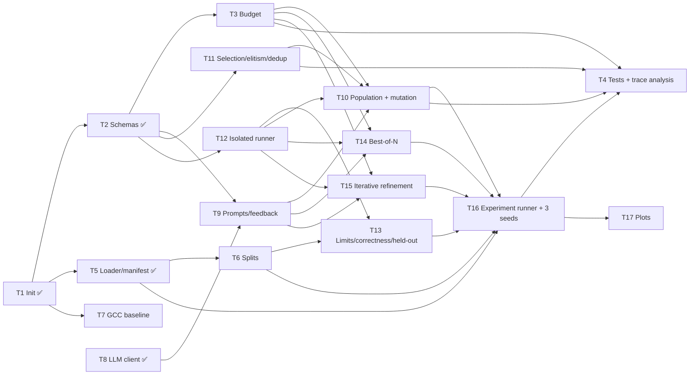

# Coding Tracking — Seminar 2

Tracking cho 17 coding task ở mục 4.2 của [Plan - Seminar 2](Plan%20-%20Seminar%202.md).
Mã task `T1`–`T17` giữ đúng thứ tự trong plan; bảng dưới sắp theo **wave** (thứ tự làm được)
và **priority**.

**Hạn nộp:** 05/10/2026. Mỗi thành viên giữ ≥ 3 task và có ≥ 3 commit của chính mình.

## Quy ước

| Ký hiệu | Ý nghĩa |
|---|---|
| ✅ | Done: đã merge vào `develop` |
| 🟡 | Một phần: có code nhưng chưa đạt Definition of Done |
| 🔵 | Đang làm, có PIC và branch |
| ⬜ | Chưa bắt đầu, không bị block |
| ⛔ | Bị block: còn task phụ thuộc chưa Done |

| Priority | Ý nghĩa |
|---|---|
| **P0** | Nằm trên critical path; thiếu thì không trả lời được RQ1/RQ2 |
| **P1** | Cần để kết quả hợp lệ (held-out, RQ3, protocol) |
| **P2** | Phân tích, test, hoàn thiện |

**Cách cập nhật:**
1. Nhận task: điền email vào cột PIC, đổi trạng thái sang 🔵 và commit thẳng file này. Nên nhận task sớm để tránh trùng.
2. Branch đặt tên `feat/T<id>-<slug>`, ví dụ `feat/T10-population`. Tiêu đề PR bắt đầu bằng `[T10]`.
3. Trong PR merge task, đổi trạng thái sang ✅. Rà lại các task trong cột **Blocks** xem đã hết bị ⛔ chưa.
4. Giao diện (mục [Interface contracts](#interface-contracts)) do T2 chốt. Sau khi chốt, ai muốn đổi phải báo nhóm, vì nhiều task code song song trên đó.

## Đồ thị phụ thuộc



**Critical path:** `T2 → T12 → T10 → T16 → T17`. Đây là chuỗi dài nhất; chậm ở bất kỳ task nào trong chuỗi thì cả nhóm chậm theo. T3, T9 và T11 phải xong trước T10.

## Bảng tracking

| Wave | ID | Task (theo plan) | Pri | Trạng thái | PIC | Depends on | Blocks |
|---|---|---|---|---|---|---|---|
| 0 | T1 | Initialize the codebase | — | ✅ | pvtd2003@gmail.com | — | T2, T5, T7 |
| 0 | T8 | Implement the LLM client | — | ✅ | huynhvancuong20@gmail.com | — | T9 |
| 1 | **T2** | Define schemas and interfaces | **P0** | ✅ | anhth.fuhn@gmail.com | T1 | T3, T9, T11, T12 |
| 1 | T5 | Implement the loader and manifest | P1 | ✅ | anhth.fuhn@gmail.com | T1 | T6, T16 |
| 1 | T7 | Build the GCC baseline for ≥ 2 tasks | P2 | 🟡 | | T1 | — |
| 1 | — | Sửa lỗi nhỏ (F1–F3, xem cuối file) | P1 | 🟡 | | — | — |
| 2 | **T12** | Implement an isolated runner | **P0** | ✅ | palasek182@gmail.com | T2 | T10, T13, T14, T15 |
| 2 | T3 | Implement budget tracking | P0 | 🔵 | palasek182@gmail.com | T2 | T4, T10, T14, T15 |
| 2 | T9 | Implement mutation prompts and feedback | P0 | ⬜ | huynhvancuong20@gmail.com | T2, T8 | T10, T14, T15 |
| 2 | T11 | Implement selection, elitism, and deduplication | P0 | 🔵 | palasek182@gmail.com | T2 | T4, T10 |
| 2 | T6 | Implement dataset splits | P1 | ⬜ | | T5 | T13, T16 |
| 3 | **T10** | Implement the population model and candidate mutation | **P0** | ⛔ | | T3, T9, T11, T12 | T4, T16 |
| 3 | T14 | Implement best-of-N | P0 | ⛔ | | T3, T9, T12 | T16 |
| 3 | T15 | Implement iterative refinement | P0 | ⛔ | | T3, T9, T12 | T16 |
| 3 | T13 | Implement timeouts, resource limits, and correctness checks | P1 | ⛔ | | T6, T12 | T16 |
| 4 | **T16** | Implement the experiment runner and run 3 seeds per method | **P0** | ⛔ | | T5, T6, T10, T13, T14, T15 | T4, T17 |
| 5 | T17 | Implement plots and analyze results | P2 | ⛔ | huynhvancuong20@gmail.com | T16 | — |
| 5 | T4 | Add lineage and budget tests, and analyze search traces | P2 | ⛔ | | T3, T10, T11 (tests); T16 (trace analysis) | — |

Cách làm song song:
- T5, T6, T7 và các bản sửa lỗi không phụ thuộc T2, nên làm được ngay từ wave 1.
- T17 có thể viết code vẽ trước trên `summary.json` của `single_call`. Chỉ phần chạy số liệu cuối mới cần T16.
- Phần unit test của T4 viết được ngay khi T3/T11 merge.

## Chi tiết task và Definition of Done

### Wave 0 — đã xong

**T1 · Initialize the codebase** ✅
Gồm package `src/asmevo`, `pyproject.toml`/`uv.lock`, `configs/default.yaml`, Dockerfile và CLI `generate`/`evaluate`.
Ghi chú: commit đầu tiên ngày 29/09, plan yêu cầu 19/09.

**T8 · Implement the LLM client** ✅
`utils/llm/client.py`: `LLMClient` Protocol và `OpenAICompatibleClient`, ghi lại token, cost và latency cho từng call.

### Wave 1 — làm ngay

**T2 · Define schemas and interfaces** · P0 · ✅
- [x] `Candidate` và `SearchTrace` trong `schemas.py` (xem [Interface contracts](#interface-contracts)), kèm `from_dict` để đọc lại trace.
- [x] Protocol `SearchMethod` dùng chung cho `best_of_n`, `refine` và `evolution` (`methods/base.py`).
- [x] Section `search:` và `split:` trong `configs/default.yaml` cùng `SearchConfig`/`SplitConfig` trong `config.py`.
- [x] Stub `evaluate_asm(...)` (T12) và `Budget`/`BudgetExhausted` (T3) có chữ ký cố định.
- **DoD:** merge được interface (có thể kèm stub `NotImplementedError`) để T3, T9, T11 và T12 bắt đầu song song.

**T5 · Implement the loader and manifest** · P1 · ✅
Loader ghim HF revision và đọc đúng file parquet đã hash (`data/dataset.py`); mỗi run có `config.json`.
- [x] Ghi `manifest.json` vào mỗi run dir (`data/manifest.py`) gồm: danh sách problem id theo split, SHA-256 của parquet, `gcc --version`, `hyperfine --version`, git commit hash và seed. `evaluate` ghi thêm toolchain lúc chấm vào `manifest["evaluate"]`.
- [x] Resume một run dir thì báo lỗi nếu dataset, problem id, split hoặc seed khác manifest. `asmevo generate --manifest <run cũ>` tạo run mới với đúng tập problem và split đó.
- **DoD:** chạy lại cùng manifest thì ra cùng tập problem và cùng split (`tests/test_manifest.py`).
- **Cho T6:** truyền split qua `build_manifest(..., splits={"dev": [...], "test": [...]})`; mặc định hiện là `{"all": [...]}`. `splits` thuộc phần reproducible nên resume sẽ kiểm tra nó.

**T7 · Build the GCC baseline for ≥ 2 tasks** · P2 · 🟡
Hiện chỉ assemble `baseline_asm` có sẵn trong dataset. Còn thiếu:
- [ ] Script compile `c_code` bằng `gcc -O3 -S` của toolchain Docker (gcc-12) cho ≥ 2 problem.
- [ ] So kết quả với `baseline_asm` của dataset: pass test không, thời gian lệch bao nhiêu. Ghi lại để dùng trong phần threats to validity.

**F1–F3 · Sửa lỗi nhỏ** · P1 — xem [cuối file](#sửa-lỗi-nhỏ).

### Wave 2 — sau khi T2 merge

**T12 · Implement an isolated runner** · P0 · ✅
Refactor `eval/runner.py`:
- [x] Tách hàm `evaluate_asm(problem, asm, tests, cfg) -> EvalResult` không phụ thuộc `Generation`, để cả 3 method gọi chung.
- [x] Cache kết quả build và test của baseline theo từng problem, tránh build lại cho mỗi candidate.
- [x] Mỗi candidate có một tempdir riêng; chạy bên trong Docker image cố định.
- [x] `measure`: bỏ `check=True` (binary lỗi khi đo thì trả về `Status.CRASH`, không làm dừng cả lượt evaluate) và bọc `prlimit` cả lúc đo.
- [x] Đo xen kẽ thật sự: chạy nhiều vòng và đổi thứ tự baseline/candidate giữa các vòng. Trả về median và stddev, không chỉ mean.
- **DoD:** một file assembly lỗi, crash hoặc lặp vô hạn chỉ làm hỏng đúng candidate đó, và process cha vẫn chạy tiếp.
- **Cho T9, T10, T13, T14, T15, T16:**
  - Đo theo ABBA cho từng test input: baseline rồi candidate, sau đó candidate rồi baseline, mỗi lượt một nửa `timing_repeats`. Mỗi test chỉ tốn 2 lần gọi hyperfine, vì dataset có trung vị 103 test/problem.
  - `speedup` = tổng median theo test của baseline / của candidate. `EvalResult` có thêm `*_median_s` và `*_stddev_s` (độ lệch của một lượt chạy hết các test).
  - Candidate phải giữ exit code của baseline; khác thì `WRONG_OUTPUT`. Output ghi ra file, giới hạn 64 MB (`--fsize`), tắt core dump. Mỗi lần chạy nằm trong process group riêng và cả group bị kill sau đó, nên không còn process mồ côi. Môi trường chạy cố định và tối thiểu.
  - `failed_test` và `dropped_tests` là vị trí trong `tests` truyền vào `evaluate_asm`, nên T9 lấy input của test fail bằng `tests[result.failed_test]`.
  - Test: `tests/test_runner.py` (15 test cần Linux x86-64, trong đó có test speedup đúng chiều và test baseline có exit code khác 0; chạy bằng lệnh Docker trong README). Trên Apple Silicon, Docker chạy giả lập nên chỉ dùng để kiểm tra pipeline chạy đúng, không dùng số đo thời gian.

**T3 · Implement budget tracking** · P0 · ⬜
- [ ] `search/budget.py`: class `Budget` tính phí mỗi lần sinh candidate (gồm cả repair và candidate lỗi), tối đa `search.max_candidates = 12`.
- [ ] Khi hết budget, gọi thêm sẽ raise `BudgetExhausted`. Ghi tổng token và cost thực tế vào `SearchTrace`.
- **DoD:** không method nào gọi LLM được quá 12 lần cho một (problem, seed). Có test kiểm tra điều này trong T4.

**T9 · Implement mutation prompts and feedback** · P0 · ⬜
- [ ] `methods/common/prompt.py` (dùng chung) gồm:
  - prompt khởi tạo: C code, assembly của parent và ràng buộc ABI (System V AMD64, callee-saved registers, căn stack 16 byte, giữ nguyên symbol, `main` và hành vi I/O);
  - prompt mutation: thêm feedback của parent.
- [ ] `format_feedback(result)` lấy stderr của assembler, test fail (input, expected, got, chỉ từ **search inputs**), signal hoặc timeout, và speedup.
- [ ] Mỗi prompt có `prompt_id` riêng để truy vết.
- **DoD:** cả prompt lẫn feedback không bao giờ chứa held-out input. T6 cung cấp ranh giới split.

**T11 · Implement selection, elitism, and deduplication** · P0 · ⬜
- [ ] `search/selection.py` gồm `tournament(pop, k, rng)`, `survive(pop, offspring, size=4)` (luôn giữ baseline, rồi chọn các candidate hợp lệ tốt nhất) và `asm_hash(asm)` (bỏ comment, khoảng trắng và directive không ảnh hưởng code).
- [ ] Candidate có fitness = −inf không bao giờ được chọn làm parent.
- **DoD:** chỉ gồm hàm thuần, chạy deterministic khi cùng `rng`, và có unit test trong T4.

**T6 · Implement dataset splits** · P1 · ⬜
- [ ] Chia problem thành `dev` (dùng để chỉnh prompt và config) và `test` (dùng cho kết quả cuối), với seed cố định.
- [ ] Trong mỗi problem, chia `tests` thành `search_tests` (dùng khi search và selection) và `heldout_tests` (chỉ dùng trong final check của T13). Problem chỉ có 1 test thì ghi rõ cách xử lý.
- **DoD:** split ghi vào manifest (T5). Có assert bảo đảm held-out không đi vào prompt hay selection.

### Wave 3 — các method tìm kiếm

**T10 · Implement the population model and candidate mutation** · P0 · ⛔ T3, T9, T11, T12
- [ ] `methods/evolution/flow.py`:
  - **Init:** baseline `-O3` vào population với fitness 1.0.
  - **Mỗi thế hệ:** tournament chọn parent, LLM mutate sinh 4 con, chạy `evaluate_asm` trên `search_tests`, rồi `survive`. Tổng cộng 3 thế hệ.
- [ ] Fitness = `T_baseline / T_candidate`; candidate không hợp lệ có fitness −inf nhưng vẫn giữ feedback.
- [ ] Mỗi candidate ghi lại `parent_ids`, `generation`, `prompt_id` và outcome vào `SearchTrace`.
- [ ] (Tùy chọn) crossover dùng LLM với 2 parent.
- **DoD:** chạy end-to-end trên ≥ 2 problem trong tập dev, tối đa 12 candidate, và trace đọc lại được.

**T14 · Implement best-of-N** · P0 · ⛔ T3, T9, T12
- [ ] `methods/best_of_n/flow.py`: 12 mẫu độc lập từ baseline, không có feedback, chọn mẫu có fitness cao nhất.

**T15 · Implement iterative refinement** · P0 · ⛔ T3, T9, T12
- [ ] `methods/refine/flow.py`: đi theo một hướng duy nhất qua 12 bước. Mỗi bước sửa candidate tốt nhất hiện có (hoặc candidate vừa sinh) theo feedback, và giữ lại candidate tốt nhất.

**T13 · Implement timeouts, resource limits, and correctness checks** · P1 · ⛔ T6, T12
Đã có timeout, giới hạn CPU/bộ nhớ/kích thước file qua `prlimit`, so sánh output và exit code với baseline (`runner.py`, T12). Còn thiếu:
- [ ] Thêm giới hạn `--nproc` (`--fsize` và `--core=0` đã có từ T12, xem `_limits` trong `eval/runner.py`).
- [ ] **Final check:** chạy candidate được chọn trên `heldout_tests`. Nếu sai, hoặc speedup không vượt ngưỡng nhiễu đo, thì fallback về baseline (1×) và ghi lý do riêng.
- [ ] Phân loại lỗi để làm RQ3: assembler error, link error, ABI hoặc crash (theo signal), wrong output, timeout.
- **DoD:** `EvalResult` cuối cùng có cả speedup trên search inputs và trên held-out, kèm cờ fallback.

### Wave 4–5 — chạy và phân tích

**T16 · Implement the experiment runner and run 3 seeds per method** · P0 · ⛔ T5, T6, T10, T13, T14, T15
- [ ] CLI `asmevo run --method {single_call,best_of_n,refine,evolution} --seed N --split {dev,test}`, resume được (giống `generate` hiện tại).
- [ ] Script chạy đủ ma trận: 4 method × 3 seed (single_call 1 seed). Gộp kết quả thành `summary.json` cho từng method, gồm mean và độ lệch giữa các seed.
- [ ] Mọi method dùng cùng model, cùng `max_output_tokens` và budget 12.
- **DoD:** có kết quả đầy đủ trên tập `test`, kèm manifest.

**T17 · Implement plots and analyze results** · P2 · ⛔ T16 (code vẽ viết trước được)
- [ ] Geomean speedup theo method, có error bar giữa các seed.
- [ ] Đường best fitness theo số candidate đã dùng (0–12).
- [ ] Tỉ lệ pass, improve và fallback; speedup trên search inputs so với held-out (RQ3).
- [ ] Phân bố loại lỗi (RQ3) và cost theo method.

**T4 · Add lineage and budget tests, and analyze search traces** · P2 · ⛔ T3, T10, T11, T16
- [ ] `tests/`: budget không vượt 12; mọi `parent_id` đều tồn tại và thuộc thế hệ trước; dedup đúng; `survive` luôn giữ baseline; `extract_asm`; `outputs_match`.
- [ ] Notebook hoặc script phân tích trace: thế hệ nào sinh ra con tốt nhất, tỉ lệ duplicate, lỗi lặp lại sau khi đã có feedback.

## Interface contracts

T2 đã chốt các giao diện dưới đây; các task khác code dựa trên chúng. Muốn đổi thì báo nhóm trước.

```python
# schemas.py
def candidate_id(problem_id: int, method: str, seed: int, n: int) -> str: ...  # n = 0 là baseline

@dataclass(frozen=True)
class Candidate:
    id: str                      # f"{problem_id}-{method}-s{seed}-{n}"
    problem_id: int
    method: str
    seed: int
    generation: int              # 0 = -O3 baseline
    parent_ids: tuple[str, ...]
    prompt_id: str | None        # None cho baseline
    asm: str | None
    asm_hash: str | None
    result: EvalResult | None    # trên search_tests
    fitness: float               # T_baseline / T_candidate; -inf nếu không hợp lệ
    feedback: str                # đưa vào prompt kế tiếp
    llm_calls: tuple[LLMCall, ...]
    valid: bool                  # property: fitness != -inf

@dataclass(frozen=True)
class SearchTrace:
    problem_id: int
    method: str
    seed: int
    candidates: tuple[Candidate, ...]   # mọi candidate đã sinh, kể cả candidate lỗi
    selected_id: str                    # candidate tốt nhất trên search_tests
    final: EvalResult                   # sau final check trên held-out (T13)
    fallback: bool
    # property: selected, llm_calls, total_cost_usd, total_output_tokens
    # Candidate/SearchTrace/EvalResult đều có from_dict để đọc lại từ JSONL

# eval/runner.py (T12)
def evaluate_asm(problem: Problem, asm: str | None,
                 tests: tuple[TestCase, ...], cfg: EvalConfig) -> EvalResult: ...

# search/budget.py (T3)
class BudgetExhausted(Exception): ...
class Budget:
    def __init__(self, max_candidates: int = 12) -> None: ...
    def charge(self) -> None: ...        # raise BudgetExhausted khi vượt
    @property
    def remaining(self) -> int: ...

# methods/base.py: Protocol SearchMethod có đúng chữ ký của search(...) dưới đây
# methods/<name>/flow.py (T10, T14, T15): NAME: str và search: SearchMethod
def search(problem: Problem, llm: LLMClient, cfg: Config,
           budget: Budget, rng: random.Random) -> SearchTrace: ...
```

```yaml
# configs/default.yaml (T2)
search:
  max_candidates: 12
  population_size: 4
  offspring_per_generation: 4
  generations: 3
  tournament_size: 2
  seeds: [0, 1, 2]
split:
  seed: 0
  dev_fraction: 0.2
  heldout_fraction: 0.3     # tỉ lệ test input của mỗi problem để dành cho final check
```

## Sửa lỗi nhỏ

| ID | Lỗi | Vị trí | Trạng thái | PIC |
|---|---|---|---|---|
| F1 | `COPY .python-version` nhưng file này không có trong repo nên `docker build` lỗi | `docker/Dockerfile:24` | ✅ | palasek182@gmail.com |
| F2 | README ghi thư mục gốc là `llm_opt/`; cần cập nhật cấu trúc và cách dùng các method mới | `README.md` | ⬜ | |
| F3 | `statistics.median` lỗi khi không có LLM call nào | `src/asmevo/eval/report.py:50` | ⬜ | |

## Theo dõi đóng góp (≥ 3 task, ≥ 3 commit mỗi người)

| Thành viên | Task đã nhận | Số commit |
|---|---|---|
| pvtd2003@gmail.com | T1 | 5 |
| huynhvancuong20@gmail.com | T8, T9, T17 | 0 |
| anhth.fuhn@gmail.com | T2, T5 | 11 |
| palasek182@gmail.com | T3, T11, T12 | 8 |

Đếm commit bằng lệnh `git shortlog -sne --all`.
